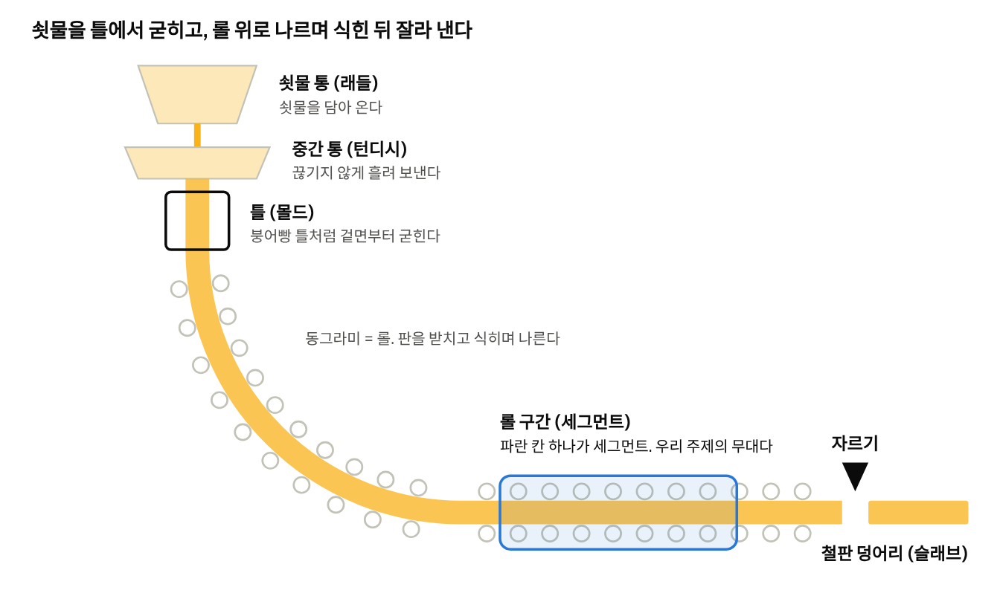
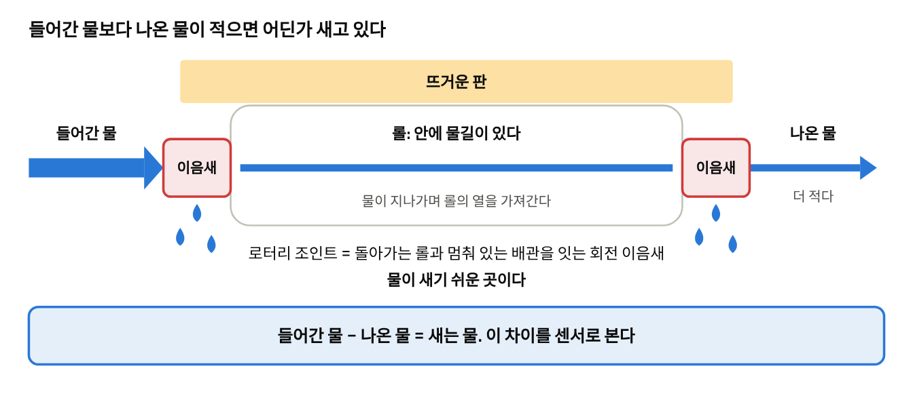
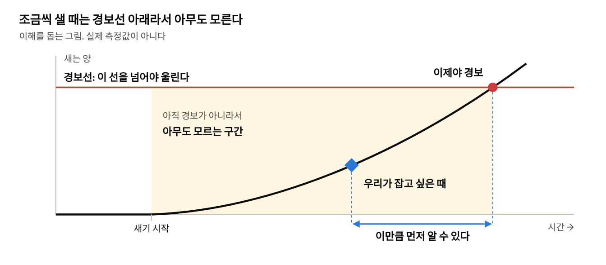
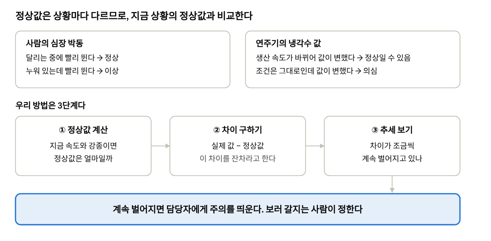
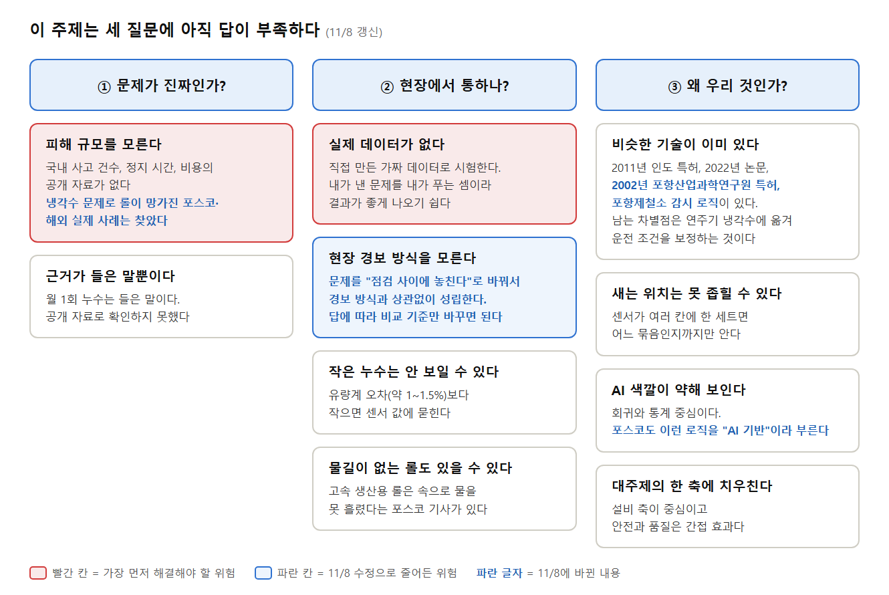

# 연주기 냉각수 누수 — 팀원용 문제 이해 가이드

Nov 7, 2026 · @Next surfer · 11/8 수정(문제 문장·차별점 표현을 02·05 문서와 맞춤, 주제는 그대로)

**한 줄 요약**: 제철소 설비 안쪽의 냉각수가 조금씩 새는 것을, 사람이 점검하기 전에 먼저 알아채는 AI를 만든다. 철강 지식이 없어도 위에서 아래로 그림만 따라가면 된다.

## 1. 연주기는 쇳물로 철판 덩어리를 만드는 기계다

가래떡 뽑는 기계를 떠올리면 쉽다. 쇳물이 굳으면서 끝없이 나오고, 롤이 이것을 받치며 나른다.

연주기의 흐름

## 2. 롤 속을 도는 물이 이음새에서 새는 문제다

자동차 냉각수와 비슷하다. 물이 롤 속을 돌며 열을 식히고 다시 돌아온다. 이 물을 **기계 냉각수**라고 부른다.

롤 속 물길과 누수 지점

냉각이 모자라면 롤이 열로 망가지고, 롤이 망가지면 생산을 멈출 수 있다 ([SAIL 특허](https://www.quickcompany.in/patents/an-improved-online-leakage-detection-system-and-water-flow-monitoring-for-machine-cooling-water-circuit-for-caster-rolls)). 판 겉면에 뿌리는 스프레이 물은 돌아오지 않아 비교할 수 없으므로 우리 범위에서 뺐다.

정리하면 **누수 → 롤이 덜 식음 → 롤이 망가짐 → 생산이 멈출 수 있음**이다. 최악의 경우 샌 물이 쇳물에 닿으면 폭발할 수도 있다(독일 연주 사고). "누수가 왜 문제냐"는 질문에는 이 흐름으로 답한다.

냉각수 문제로 롤이 실제로 망가진 사례도 있다.
- **포스코**: 고속 주조용 세그먼트에서 롤 속으로 냉각수가 흐르지 못하자, 설치 다음 날 롤이 "새까맣게 타버린" 채 못 쓰게 됐다([포스코명장 인터뷰 ⑬](https://newsroom.posco.com/kr/%ED%8F%AC%EC%8A%A4%EC%BD%94%EB%AA%85%EC%9E%A5-%ED%8A%B9%EB%B3%84-%EC%9D%B8%ED%84%B0%EB%B7%B0%E2%91%AC-%EC%97%B0%EC%A3%BC%EC%84%A4%EB%B9%84-%EB%B6%84%EC%95%BC%EC%97%90%EC%84%9C-%ED%8F%AC%EC%8A%A4/)).
- **브라질 ArcelorMittal 제철소**: 냉각수 통로가 서서히 막히면서 세그먼트 베어링이 계속 깨졌다([ABM 2014](https://abmproceedings.com.br/en/article/anlise-de-falhas-nos-rolamentos-da-mquina-de-lingotamento-contnuo-3-da-arcelormittal-tubaro)). "서서히 나빠진다"는 점이 우리 문제와 같다.

둘 다 누수 사례는 아니고, "냉각수가 모자라면 롤이 망가진다"를 보여 주는 실제 사례다. 국내에서 누수로 몇 번 멈췄는지 같은 숫자는 공개 자료가 없어서 말하지 않는다.

그런데 유량이 이상하다고 다 누수는 아니다. 배관이 막히거나 펌프가 약해지거나 유량계가 고장 나도 값이 변한다. 그래서 우리 화면은 **"누수 같아요 / 막힘 같아요 / 펌프 같아요"를 구분**해서, 누수인 줄 알고 뜨거운 연주기 옆을 뒤지는 **헛걸음을 줄인다.** 구분 규칙은 아직 가설이다.

## 3. 조금씩 새면 점검과 점검 사이에 아무도 모른다

변기에서 물이 조금씩 새도 수도 요금을 볼 때까지 모르는 것과 비슷하다. 사람이 점검하는 사이에 조금씩 커지면 다음 점검 때까지 아무도 알아채지 못한다. 게다가 생산 속도나 강종이 바뀌면 센서 값도 원래 출렁이기 때문에, 작은 변화는 그 출렁임에 묻혀 화면으로 봐도 잘 보이지 않는다.

건강검진에 비유하면, 1년에 한 번 검사하는 사이에 혈압이 조금씩 오르면 모른다. 운동 직후에 재면 원래 높게 나오니 "조금 높네" 하고 넘어간다.

경보선과 아무도 모르는 구간

그림의 경보선은 [인도 제철소 특허](https://www.quickcompany.in/patents/an-improved-online-leakage-detection-system-and-water-flow-monitoring-for-machine-cooling-water-circuit-for-caster-rolls) 방식을 예로 든 것이다. 이 특허의 경보 기준은 목표 유량과 20% 차이라서, 목표가 분당 2,600 L인 구간이면 분당 약 520 L가 달라져야 울린다(우리 계산). **포스코의 실제 경보 방식과 기준은 아직 모른다.** 그래서 "포스코 경보가 늦다"고 주장하지 않고, 이런 고정 경보선은 시연에서 우리 방법과 나란히 놓는 **비교 기준**으로만 쓴다. 실제로 포항제철소는 다른 설비에서 이미 고정선보다 나은 감시 로직을 쓰고 있다(4절).

## 4. 우리 아이디어: 지금 상황의 정상값과 비교한다

경보선 하나를 쓰면 낮출 때는 오경보가 늘고, 높일 때는 더 늦게 안다. 그래서 고정된 선 대신 상황에 맞는 정상값을 쓴다. 쓰는 사람은 설비 담당자이고, 이 사람이 정할 것은 **"지금 보러 갈까, 다음 점검까지 둘까"** 하나다.

심장 박동 비유와 우리 방법 3단계

**이 생각은 포스코에도 이미 있다.** [포스코 뉴스룸 2026-04-23](https://newsroom.posco.com/kr/%ED%8F%AC%ED%95%AD%EC%A0%9C%EC%B2%A0%EC%86%8C-ai-%EA%B8%B0%EB%B0%98-%EC%8A%A4%EB%A7%88%ED%8A%B8-%EC%A0%95%EB%B9%84-%EC%8B%9C%EC%8A%A4%ED%85%9C%EC%9C%BC%EB%A1%9C-%EC%98%88%EC%A7%80%EC%A0%95%EB%B9%84/) 기사(11/8 원문 확인)에 따르면 포항제철소는 이런 감시를 하고 있다.

| 설비 | 무엇을 보나 | 우리 방법과 같은 점 |
|---|---|---|
| 3고로 풍구 (쇳물 만드는 용광로의 바람구멍) | 유량·온도 이상이 **일정 시간 계속되면** 알람 | 같은 센서, "잠깐 튄 값은 무시하고 계속되면 알린다" = ③ 추세 보기 |
| 가열로 밸브 | 밸브 열림 대비 가스 유량 그래프의 **기울기가 평소와 다르면** 이상 | "조건에 맞는 정상값과 비교" = ① 정상값 계산 |
| 기름 탱크 | **전일 대비** 기름 양이 비정상적으로 줄면 감지 | 작은 누출을 사람 대신 데이터로 본다 |

그래서 우리는 "세상에 없던 방법"이라고 하지 않는다. **"포항제철소가 다른 설비에서 쓰는 감시 방식을, 아직 적용 사례가 없는 연주기 롤 냉각수로 옮기고 주조 속도·강종을 한꺼번에 보정한다"**고 말한다. 현장 심사위원에게는 이쪽이 "현장에서 쓸 수 있겠다"로 들린다. 단, 기사에 "냉각수"라는 말은 없으니 풍구 사례를 냉각수 감시라고 단정하지 않는다.

## 5. 이 주제를 골랐을 때의 문제점

가장 큰 위험은 **실제 데이터 없이 현장 문제를 풀었다고 말해야 한다**는 점이다. 데모는 가짜 데이터로 만들 수 있지만, 현장 효과는 말할 수 없다.

이 주제의 문제점 10가지 (11/8 갱신: 파란 칸·파란 글자가 바뀐 부분)

**11/8 수정으로 달라진 칸**

| 그림의 칸 | 11/8 이후 |
|---|---|
| ① 피해 규모를 모른다 | 국내 사고 숫자는 여전히 모른다. 다만 "누수 → 롤이 덜 식음 → 롤 손상·생산 중단"은 특허로 확인된 구조이고, 냉각수 문제로 롤이 망가진 포스코·해외 실제 사례도 찾았다(2절) |
| ② 현장 경보 방식을 모른다 | 여전히 모른다. 다만 주 문제를 "점검 사이에 놓친다"로 바꿔서 **경보 방식과 상관없이 성립**한다. 주 문제를 다시 쓸 위험은 사라졌고, 답에 따라 비교 기준만 바꾸면 된다 |
| ③ 비슷한 기술이 이미 있다 | 특허·논문에 더해 포항제철소 감시 로직도 같은 생각이다. 롤 냉각수 유량·온도로 롤 수명을 예측하는 [포항산업과학연구원 특허(2002)](https://patents.google.com/patent/KR20040020481A/ko)도 있다(목적은 수명 예측이라 누수 감지와 다르다). 그래서 차별점을 "연주기 냉각수로 옮기고 여러 운전 조건을 함께 보정"으로 좁혀 말한다 |
| ③ AI 색깔이 약해 보인다 | 포스코도 이런 데이터 분석 로직을 "AI 기반"이라고 부른다(같은 기사). 화려하진 않지만 현장 방식과 맞다고 말한다 |
| 나머지 칸 | 그대로 |

그림의 근거: [인도 제철소 특허(2011 출원)](https://www.quickcompany.in/patents/an-improved-online-leakage-detection-system-and-water-flow-monitoring-for-machine-cooling-water-circuit-for-caster-rolls), [Prasad 외 2022 논문(본문 미확인)](https://doi.org/10.1016/j.matpr.2022.06.305), [포스코명장 인터뷰 ⑬](https://newsroom.posco.com/kr/%ED%8F%AC%EC%8A%A4%EC%BD%94%EB%AA%85%EC%9E%A5-%ED%8A%B9%EB%B3%84-%EC%9D%B8%ED%84%B0%EB%B7%B0%E2%91%AC-%EC%97%B0%EC%A3%BC%EC%84%A4%EB%B9%84-%EB%B6%84%EC%95%BC%EC%97%90%EC%84%9C-%ED%8F%AC%EC%8A%A4/). 포스코 기사의 고속 생산용 롤이 어느 공장 설비인지, 이후 어떻게 해결했는지는 기사에 없다. 유량계 오차는 [02](https://github.com/yurim6263/segnal/blob/main/02_%EC%A3%BC%EC%A0%9C_%EB%AC%B8%EC%A0%9C%EC%A0%95%EC%9D%98%EC%99%80_%ED%95%B4%EA%B2%B0.md)·[04](https://github.com/yurim6263/segnal/blob/main/04_%EA%B7%BC%EA%B1%B0%EC%9E%90%EB%A3%8C_%EC%88%98%EC%A7%91.md) 문서에 적힌 특허 서술 기준이다.

## 6. 더 찾아야 할 데이터

가장 급한 것은 **실제 센서 기록 한 구간과 현재 경보 기준**이다. 위 8개는 회사 안에만 있고, 우리가 지금 바로 찾을 수 있는 것은 아래 2개다.

| 부족한 데이터 | 왜 필요한가 | 어디에 있나 | 못 구하면 |
|---|---|---|---|
| 실제 센서 기록: 유량·압력·온도, 생산 속도, 강종 (몇 시간 분량) | 가짜 데이터가 현실과 비슷한지 확인한다 | 회사 내부 | 가짜 데이터 결과라고 먼저 밝힌다 |
| 현재 경보 방식과 기준값 | 시연의 비교 기준을 현장 방식에 맞춘다 | 회사 내부 | 고정 경보선을 비교용 가정이라고 밝힌다 |
| 센서 위치와 세그먼트 칸 수 | 어디까지 좁힐 수 있는지 정한다 | 회사 내부 설비 자료 | 13칸·5묶음 가정을 유지한다 |
| 과거 누수 기록: 날짜, 위치, 크기, 조치 | 문제의 크기를 보여 주고, 실제 정답지가 된다 | 정비 일지 | 빈도를 수치로 말하지 않는다 |
| 피해 규모: 정지 시간, 수리 비용 | 왜 풀 가치가 있는지 보여 준다 | 회사 내부 | 금액 없이 말한다 |
| 유량계 정확도와 점검 주기 | 얼마나 작은 누수까지 보이는지 정한다 | 계기 사양서 | 최소 감지량을 말하지 않는다 |
| 위치를 찾는 데 걸리는 시간과 방법 | 위치 찾기 기능의 가치를 정한다 | 회사 내부 | 위치 기능은 보조로 둔다 |
| 막힘·펌프 고장 때의 센서 변화 | 원인 구분 규칙을 검증한다 | 정비 기록 | 원인 구분은 가설이라고 밝힌다 |
| [Prasad 외 2022 논문](https://doi.org/10.1016/j.matpr.2022.06.305) 전문 | 우리 차별점과 겹치는지 확인한다 | 도서관, 유료 구매, 저자 문의 | 차별점을 단정하지 않는다 |
| 국내 논문·특허·재해 사례 | 해외 사례뿐인 근거를 보강한다 | [RISS](https://www.riss.kr), [KCI](https://www.kci.go.kr), [KIPRIS](https://www.kipris.or.kr), [KOSHA](https://www.kosha.or.kr) | 해외 사례라고 밝히고 쓴다 |

## 어려운 말 풀이

| 말 | 쉬운 뜻 |
|---|---|
| 연주기 | 쇳물을 굳혀 철판 덩어리를 뽑는 기계 |
| 슬래브 | 연주기에서 나오는 두꺼운 철판 덩어리 |
| 세그먼트 | 롤을 묶어 놓은 한 칸 |
| 로터리 조인트 | 돌아가는 롤과 멈춘 배관을 잇는 회전 이음새 |
| 기계 냉각수 | 롤 속을 돌고 돌아오는 물 |
| 고정 임계값 | 넘으면 경보가 울리는 정해진 선. 우리는 시연의 비교 기준으로 쓴다 |
| 풍구 | 고로(쇳물 만드는 용광로) 아래쪽에서 뜨거운 바람을 불어 넣는 구멍 |
| 잔차 | 실제 값과 정상값의 차이 |
| 합성 데이터 | 시뮬레이터로 만든 가짜 데이터 |

## 더 읽을 자료

1. [포스코명장 인터뷰 ⑳](https://newsroom.posco.com/kr/%ED%8F%AC%EC%8A%A4%EC%BD%94%EB%AA%85%EC%9E%A5-%ED%8A%B9%EB%B3%84-%EC%9D%B8%ED%84%B0%EB%B7%B0%E2%91%B3-%EB%B8%94%EB%9E%99%EC%95%84%EC%9B%83%EC%9D%84-%EB%A7%89%EC%95%84%EB%9D%BC-%EC%A0%9C%EC%B2%A0/): 연주 공정을 붕어빵 틀에 비유해 설명한다. 처음 읽기에 가장 좋다.
2. [포스코 뉴스룸 2026-04-23: 포항제철소 AI 기반 스마트 정비](https://newsroom.posco.com/kr/%ED%8F%AC%ED%95%AD%EC%A0%9C%EC%B2%A0%EC%86%8C-ai-%EA%B8%B0%EB%B0%98-%EC%8A%A4%EB%A7%88%ED%8A%B8-%EC%A0%95%EB%B9%84-%EC%8B%9C%EC%8A%A4%ED%85%9C%EC%9C%BC%EB%A1%9C-%EC%98%88%EC%A7%80%EC%A0%95%EB%B9%84/): 4절의 풍구·가열로 밸브·기름 탱크 사례. 짧아서 5분이면 읽는다.
3. [포스코명장 인터뷰 ⑬](https://newsroom.posco.com/kr/%ED%8F%AC%EC%8A%A4%EC%BD%94%EB%AA%85%EC%9E%A5-%ED%8A%B9%EB%B3%84-%EC%9D%B8%ED%84%B0%EB%B7%B0%E2%91%AC-%EC%97%B0%EC%A3%BC%EC%84%A4%EB%B9%84-%EB%B6%84%EC%95%BC%EC%97%90%EC%84%9C-%ED%8F%AC%EC%8A%A4/): 냉각이 모자라 롤이 타 버린 실제 이야기가 나온다.
4. [02\_주제\_문제정의와\_해결.md](https://github.com/yurim6263/segnal/blob/main/02_%EC%A3%BC%EC%A0%9C_%EB%AC%B8%EC%A0%9C%EC%A0%95%EC%9D%98%EC%99%80_%ED%95%B4%EA%B2%B0.md): 우리 팀의 자세한 문제 정의다. 이 문서를 본 뒤에 읽는다.
