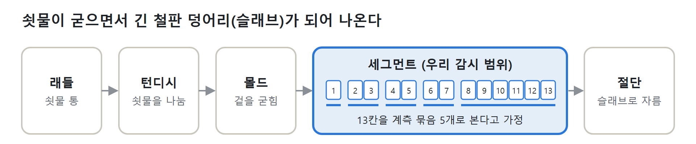
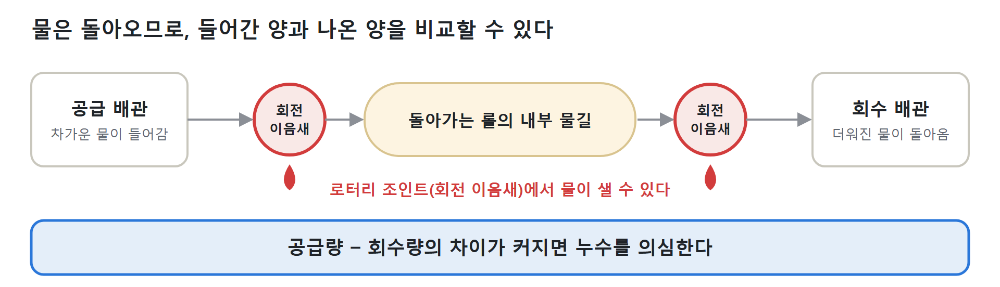
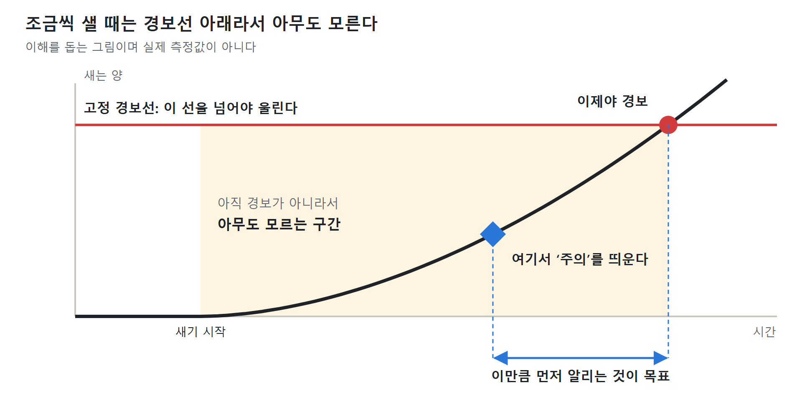
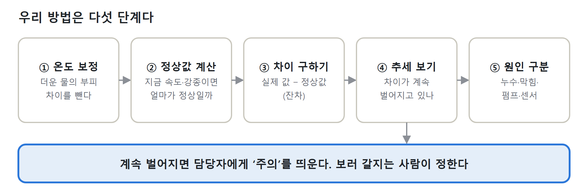
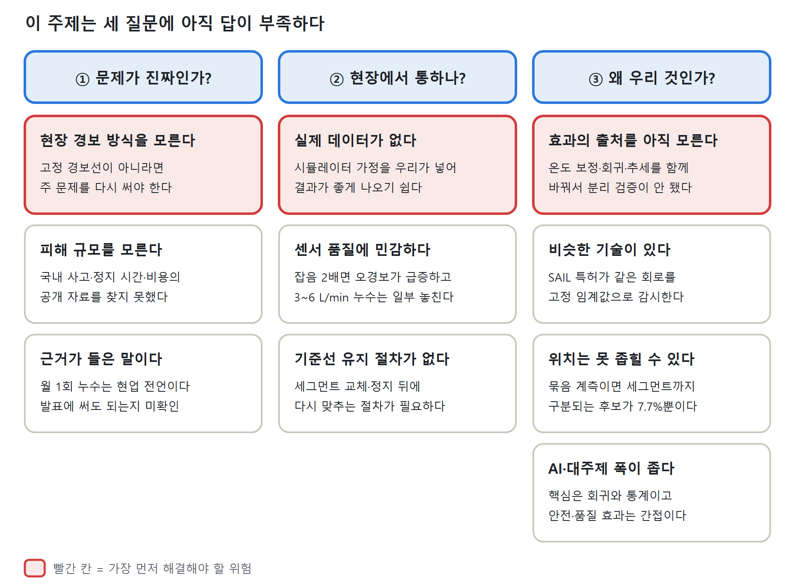

# 연주기 냉각수 누수 — 팀원용 문제 이해 가이드

기준: 프로젝트 문서 01\~05, repo 구현과 평가 결과 (2026-11-08, 5·6절은 2026-11-09 재측정 반영) · 주 문제·범위는 팀 회의 확정 전의 결정안 · 숫자가 다르면 `08_구현현황과_검증_2026-11-09.md`를 따른다

> **한 줄 요약:** 제철소 설비 안쪽의 냉각수가 조금씩 새는 것을, 고정 경보선이 울리기 전에 “주의”로 알려 주는 AI 보조 시스템을 만든다. 데이터는 전부 가상이다. 철강 지식이 없어도 위에서 아래로 그림만 따라가면 된다.

## 1. 연주기는 쇳물로 철판 덩어리를 만드는 기계다

가래떡 뽑는 기계를 떠올리면 쉽다. 쇳물이 굳으면서 끝없이 나오고, 롤이 이것을 받치며 나른다. 롤을 묶어 놓은 한 칸을 세그먼트라고 부른다.

*연주기의 흐름. 13칸·5묶음은 가정이며 repo의 config/plant.yaml에서 바꾼다.*

## 2. 롤 속을 도는 물이 이음새에서 새는 문제다

자동차 냉각수와 비슷하다. 물이 롤 속을 돌며 열을 식히고 다시 돌아온다. 이 물을 **기계 냉각수**라고 부른다.

*기계 냉각수 회로와 누수 지점*

누수는 롤 열피로 파손, 롤 소모 증가, 주조 중단, 주편 표면 결함으로 이어질 수 있다(SAIL 특허 서술). 냉각수가 쇳물에 닿으면 수증기 폭발 위험도 있다. 판 겉면에 뿌리는 스프레이 물은 돌아오지 않아 비교할 수 없으므로 우리 범위에서 뺐다.

## 3. 조금씩 새면 경보가 늦게 울린다

변기에서 물이 조금씩 새도 수도 요금을 볼 때까지 모르는 것과 비슷하다. 많이 새야 경보가 울리는 방식이라면 그 전까지는 아무도 알아채지 못한다.

*경보선과 아무도 모르는 구간*

공개된 인도 SAIL 특허의 기준은 유량 편차 20%, 온도차 15℃다. 우리 가상 설비의 묶음 8–13(약 2,600 L/min)에 20%를 적용하면 약 520 L/min이 달라져야 울린다는 뜻이다(우리 계산). **포스코가 이 방식인지, 기준값이 얼마인지는 아직 모른다.**

이 시스템을 쓰는 사람은 설비 담당자 한 명으로 잡았다. 이 사람이 정할 것은 “지금 사람을 보내 볼까, 다음 정기 점검까지 둘까”와, 보낸다면 어느 묶음부터 볼지다.

## 4. 우리 방법: 지금 상황의 정상값과 비교하고 추세를 본다

달리는 중에 심장이 빨리 뛰는 것과 누워 있는데 빨리 뛰는 것은 다르다. 설비의 유량·압력·온도도 주조 속도와 강종에 따라 달라지므로, 고정된 선 대신 지금 상황의 정상값과 비교한다.

*우리 방법의 다섯 단계*

> **헷갈리기 쉬운 점:** 공급−회수 차이는 순환 회로라서 주조 속도의 영향을 거의 받지 않는다. 회수 쪽 물이 뜨거워 부피가 늘어 보이는 효과(약 1\~2.5%)는 ①이 없애고, 속도를 바꾼 직후의 짧은 지연은 ②가 잡는다. 공급 유량·압력·온도차는 속도에 따라 움직이므로 ②의 정상값이 ⑤ 원인 구분에 쓰인다.

그다음은 보조 기능이다. 계측이 허락하면 점검 위치 후보를 보여 주고, 점검 결과를 입력하면 후보를 갱신하며, 인수인계 노트 5항목을 템플릿으로 만든다. 새 장비를 달지 않고, 판단 근거를 화면에 보여 주며, 설비를 직접 제어하지 않고, 최종 판단은 사람이 한다.

## 5. 지금까지 만든 것과 나온 결과

웹 대시보드는 감시, 진단, 점검, 인수인계, 비교·지표, 시나리오의 6개 화면으로 구현돼 있다(FastAPI + React + SQLite). 아래는 묶음 계측, 무작위 누수 30건의 평가 결과다.

| 지표 (가상 데이터) | 고정 임계값 | 우리 방식 (추세 감지) |
| --- | --- | --- |
| 감지한 누수 | 16 / 30건 | 30 / 30건 |
| 감지까지 걸린 시간 (중앙값) | 455분 (감지한 16건 기준) | 59.5분 |
| 감지 시점의 누수량 (중앙값) | 16.5 L/min | 10.2 L/min |
| 오경보 (14일·묶음당, 누수 직전 구간) | 0.20건 | 0.00건 |

비교 대상인 고정 임계값은 특허의 20%를 그대로 쓴 것이 아니라, 부피유량 차이에 같은 오경보 목표로 맞춘 값이다. 우리 방식은 EWMA λ=0.1 기준이다.

- **계측 단위의 영향이 크다.** 세그먼트마다 계측하면 고정 임계값도 30건을 모두 잡는다(47.5분, 우리 방식 18.5분).
- **정상 30일을 이어서 돌리면 오경보가 0이 아니다.** 공장 전체로 우리 방식 월 약 4.7건, 고정 임계값 월 약 3.3건이다. 유량계가 얼마나 틀어지는지(표류)에 크게 달려 있어서, 표류가 없으면 0건이고 2배면 우리 방식이 월 168건으로 급증한다. 위 표의 0.00건은 "누수 직전 1\~1.5일" 구간의 값이다. 그래서 "오경보 없이"라고 말하지 않는다.
- **빨라진 이유의 대부분은 평균이다.** 같은 기준으로 60분 이동평균만 써도 80.5분(보정 없음), 운전 조건 보정을 더하면 62분이다. 우리 방식 59.5분과 속도는 비슷하고, 차이는 오경보다(이동평균 2.4\~3.0건 대 0.00건). 운전 조건 보정을 빼고 EWMA만 쓰면 202분으로 늦다.
- **원인 구분** 정확도는 84.8%(66건 중 56건)다. 다만 실제 누수 30건 중 5건은 센서 이상, 1건은 미상으로 분류됐다.
- **위치**는 어느 묶음인지는 100% 맞혔지만, 묶음 계측에서 세그먼트까지 구분되는 후보는 7.7%뿐이다. 세그먼트 상위 3개 적중률 63.3%는 묶음 안에서 무작위로 3개를 고르는 경우(계산값 76.9%)보다 낮다. 그래서 “어느 묶음”까지만 약속하는 쪽이 기획서의 게이트 기준에 맞는다.
- **민감도:** 임계값을 다시 맞추지 않으면 센서 잡음 2배에서 오경보가 0.14건에서 30.75건으로 늘고, 3\~6 L/min 누수는 30건 중 8건을 놓친다.
- **ML 비교:** Isolation Forest와 오토인코더도 같은 조건에서 시험했지만 단순 추세 감지보다 늦거나 오경보가 많았다. MVP 범위에서는 옵션으로 내렸다.

## 6. 이 주제를 골랐을 때의 문제점

가장 큰 위험은 실제 데이터 없이 현장 문제를 풀었다고 말해야 한다는 점이다. 이 허점들의 자세한 목록과 저장소 검증 결과는 `07_치명_허점_해결방안.md`와 `08` §4에 있다. 데모는 가상 데이터로 만들 수 있지만, 현장 효과는 말할 수 없다.

*이 주제의 문제점 10가지*

> **가장 먼저 답할 질문:** “온도 보상한 유량 차이에 추세 감지만 걸어도 되는 것 아닌가?” 11/9에 일부를 잰 결과: 평균(60분 이동평균)만으로 고정 임계값 455분이 80.5분이 되고, 운전 조건 보정을 더하면 62분, EWMA까지 쓰면 59.5분(오경보는 2.36 → 0.00)이다. 즉 **속도 향상의 대부분은 평균이고, 우리 몫은 같은 속도에서 낮은 오경보**다. 아직 하지 않은 것: 온도 보정(질량유량 환산) 자체를 뺀 비교, 시뮬레이터의 지연 설정을 바꿔 보정 효과가 얼마나 남는지 보는 실험.

그래서 발표에서는 공개 자료로 확인한 것, 현업 전언, 미확인을 나눠서 말한다. 효과는 금액이나 시간으로 주장하지 않고, 같은 시나리오에서 고정 임계값과 비교한 차이로만 보인다.

## 7. 더 찾아야 할 데이터

가장 급한 것은 현재 경보 방식과 실제 센서 기록 한 구간이다. 현업에 보낼 문안은 [repo/docs/현업_질문_요청.md](repo/docs/현업_질문_요청.md)에 있고, 발송은 팀이 직접 한다.

| 부족한 데이터 | 왜 필요한가 | 어디에 있나 | 못 구하면 |
| --- | --- | --- | --- |
| 현재 경보 방식과 기준값 | 고정 경보선이 맞아야 비교가 성립한다 | 회사 내부 (질문 2) | 고정 경보선은 가정이라고 밝힌다 |
| 실제 센서 기록: 유량·압력·온도, 주조 속도, 강종 (몇 시간 분량) | 가상 데이터가 현실과 비슷한지 확인한다 | 회사 내부 (질문 10) | 가상 데이터 결과라고 먼저 밝힌다 |
| 계측 단위와 세그먼트 칸 수 | 어디까지 좁힐 수 있는지 정한다 | 회사 내부 (질문 1) | 13칸·5묶음 가정을 유지한다 |
| “월 1회”의 뜻과 전언 사용 허락 | 문제의 크기를 말하는 근거다 | 현업 (질문 4) | 빈도를 수치로 말하지 않는다 |
| 전언의 회로가 기계 냉각수가 맞는지 | 우리 범위와 맞는지 확인한다 | 현업 (질문 5) | 확인 전이라고 밝힌다 |
| 피해 규모: 정지 시간, 수리 비용 | 왜 풀 가치가 있는지 보여 준다 | 회사 내부 | 금액·시간 효과를 주장하지 않는다 |
| 위치를 찾는 데 걸리는 시간과 방법 | 위치 찾기 기능의 가치를 정한다 | 회사 내부 (질문 3) | 위치 기능은 보조로 둔다 |
| 유량계 정확도와 교정 주기 | 얼마나 작은 누수까지 보이는지 정한다 | 계기 사양서 | 최소 감지량은 시뮬레이션 가정으로만 말한다 |
| 막힘·펌프 고장 때의 센서 변화 | 원인 구분 규칙을 검증한다 | 정비 기록 | 원인 구분은 가설이라고 밝힌다 |
| 로터리 조인트 교체 이력 | 수명 모델(옵션)의 근거가 된다 | 현업 (질문 6) | 옵션으로 두고 주장하지 않는다 |

## 8. 앞으로의 일정

| 날짜 | 할 일 |
| --- | --- |
| 11/8 (일) | 분리도 검증 판단, 민감도, 점검 피드백, 인수인계 템플릿, 통합 리허설, 발표 문장(전언·확인·미확인) 확정 — **분리도·민감도·피드백·템플릿은 완료**, 리허설과 발표 문장은 미완 |
| 11/9 (월) | 09:00 시작과 Challenge 안내 확인, 14:00\~20:00 집중 개발, 20:00 기능 동결, 영상·보고서·발표자료 |
| 11/10 (화) | 02:00 결과물 제출, 본선 5팀 선정 후 14:00\~18:00 최종 발표 |

## 어려운 말 풀이

| 말 | 쉬운 뜻 |
| --- | --- |
| 연주기 | 쇳물을 굳혀 철판 덩어리를 뽑는 기계 |
| 슬래브 (주편) | 연주기에서 나오는 두꺼운 철판 덩어리 |
| 세그먼트 | 롤을 묶어 놓은 한 칸 |
| 계측 묶음 | 센서 한 세트로 함께 재는 세그먼트 무리 |
| 로터리 조인트 | 돌아가는 롤과 멈춘 배관을 잇는 회전 이음새 |
| 기계 냉각수 | 롤 속을 돌고 돌아오는 물 |
| 고정 임계값 | 넘으면 경보가 울리는 정해진 선 |
| 질량유량 | 온도에 따른 부피 변화를 뺀 유량 |
| 잔차 | 실제 값과 정상값의 차이 |
| EWMA | 최근 값에 더 무게를 둔 평균으로 추세를 보는 방법 |
| 오경보 | 정상인데 울린 경보 |
| 합성 데이터 | 시뮬레이터로 만든 가상 데이터 |

## 더 읽을 자료

1. [05_기획서_요약.md](05_기획서_요약.md): 프로젝트 전체를 2쪽으로 본다. 이 가이드 다음에 읽는다.
2. [02_주제_문제정의와_해결.md](02_주제_문제정의와_해결.md): 문제 정의와 근거 수준을 자세히 본다.
3. [03_팀_구현내용.md](03_팀_구현내용.md): 무엇을 어떤 순서로 만드는지 본다.
4. [04_근거자료_수집.md](04_근거자료_수집.md): 특허·논문 등 근거와 확인 수준을 본다.
5. [07_치명_허점_해결방안.md](07_치명_허점_해결방안.md): 기획서의 가장 큰 허점 6가지와 해결 방법을 본다.
6. [08_구현현황과_검증_2026-11-09.md](08_구현현황과_검증_2026-11-09.md): 무엇이 구현됐고 어떤 수치가 나왔는지, 07의 주장을 저장소로 검증한 결과를 본다. 숫자가 다르면 이 문서가 기준이다.
