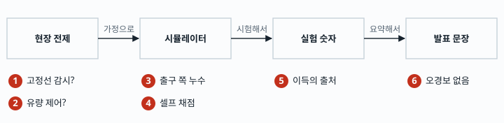
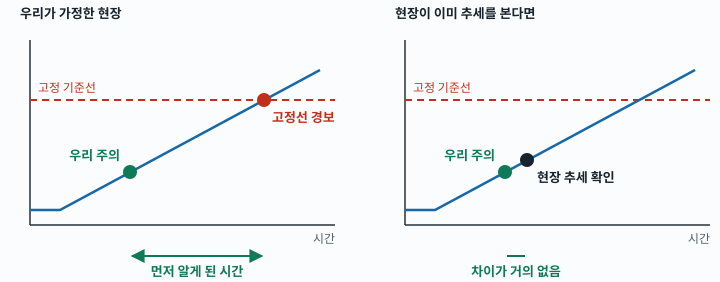
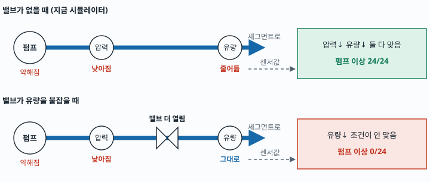
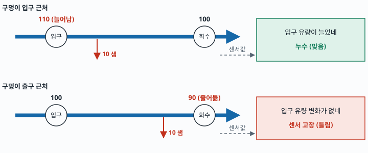
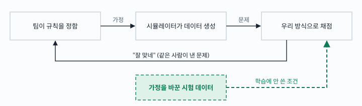
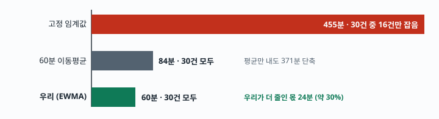
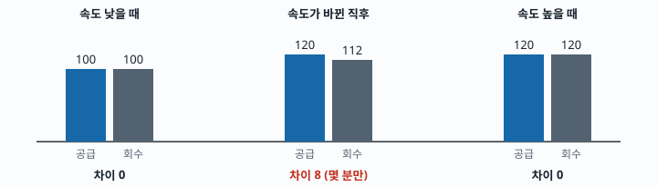
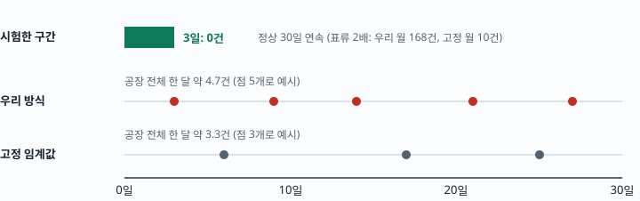

# 연주기 누수 프로젝트의 가장 심각한 허점 6가지

PDF에서 "치명" 등급을 받은 7개를 6가지로 묶었습니다. 지금 상태로는 "**고정 임계값보다 먼저, 오경보 없이**"라고 말할 수 없습니다. 고칠 방법은 있고, 일부는 오늘 안에 끝납니다.

> **임계값** 경보가 울리는 기준선입니다. "유량 차이가 20%를 넘으면 경보"에서 20%가 임계값입니다.

> **오경보** 실제로는 아무 일도 없는데 울린 경보입니다.

앞쪽이 틀리면 뒤쪽이 전부 흔들리므로 왼쪽부터 번호를 붙였습니다. 오늘 코드와 문장으로 바로 고칠 수 있는 것은 3번, 5번, 6번입니다. 1번과 2번은 확인할 방법이 없는 전제라서, 가정임을 밝히고 어느 쪽이든 버티게 준비합니다.

**표시 읽는 법.** [PDF A1]은 PDF의 항목 번호, [코드 확인]은 제가 저장소 코드를 직접 읽은 것, [제 제안]은 PDF에 없고 제가 더한 것입니다. PDF의 숫자는 모두 합성 데이터 기준이고, 제가 다시 돌리지는 않았습니다.

## 1. 현장이 정말 고정선으로 감시하는지 모릅니다

우리 자랑은 "고정선보다 먼저 안다"입니다. 그런데 현장이 고정선만 쓴다는 것은 팀의 추정입니다. [PDF A1] 현장이 이미 추세를 보고 있다면 우리가 앞선 시간이 확 줄어듭니다.

파란 선은 서서히 커지는 누수 신호입니다. 위치와 간격은 이해를 돕기 위한 개념 그림이고 측정값이 아닙니다.

> **추세** 값 하나가 아니라 값이 어느 쪽으로 계속 움직이는지 보는 것입니다.

> **SAIL 특허** 인도 제철소의 공개 특허입니다. 공급과 회수 유량 차이를 고정선으로 감시하는 방식이 적혀 있어, 지금 우리가 비교 기준으로 쓰고 있습니다.

### 해결 방법

1. **비교 상대를 둘로 늘립니다.** 현장이 고정선만 쓰는 경우는 고정 임계값과, 현장이 추세를 보는 경우는 60분 이동평균과 비교합니다. 5번의 막대그림이 바로 이 비교입니다.
2. **기준값을 하나로 정하지 않습니다.** 고정선을 여러 값으로 바꿔 가며 잽니다. 낮출수록 오경보가 늘고 높일수록 늦어지는 관계를 그래프로 보여 주면, 현장 기준값이 얼마든 읽을 수 있습니다. [PDF B5]
3. **"먼저 안다" 하나에 기대지 않습니다.** DCS에 추세 화면이 있어도 사람이 계속 들여다봐야 합니다. 우리 가치는 "사람이 안 봐도 대신 지켜보다 알려 준다"가 됩니다. [PDF A7]
4. **발표에서 가정임을 먼저 밝힙니다.** 아래 문장을 그대로 쓰면 됩니다.

> **DCS** 공장 설비의 값을 모아 보여 주고 제어하는 중앙 관제 시스템입니다.

> **발표에서 이렇게:** "현장 기준은 공개 자료로 확인되지 않아, 특허의 고정선 방식과 이동평균을 모두 비교 기준으로 삼았습니다."

**맞는지 확인하는 법.** `02_주제_문제정의와_해결.md` §3.1에 "미확인"이라고 적혀 있습니다. 공개 자료로는 확인할 수 없는 전제입니다.

## 2. 유량을 붙잡는 밸브가 있으면 판정 규칙이 고장 납니다

시뮬레이터에는 유량을 자동으로 맞추는 장치가 없습니다. 실제 회로에 있다면 펌프 이상을 하나도 못 잡습니다. [PDF C2] 샤워기로 치면, 수압이 약해져도 수도꼭지를 더 틀어 물줄기를 똑같이 유지하는 상황입니다.

같은 고장인데 밸브 하나로 판정이 24건에서 0건이 됩니다. 판정 규칙이 "압력과 유량이 함께 떨어진다"에 기대고 있기 때문입니다.

> **세그먼트** 쇳물이 굳은 판을 받치고 식히는 롤 묶음 한 칸입니다.

> **펌프 이상** 물을 미는 펌프의 힘이 약해진 고장입니다. 코드 규칙은 여러 묶음에서 압력과 유량이 함께 떨어질 때를 이렇게 부릅니다.

**제가 코드에서 더 찾은 것** [제 제안 · 실행 안 해 봄] 누수 규칙도 같은 함정에 걸립니다. `classify.py` 108~110줄은 "입구 유량이 늘어나야 누수"로 봅니다. 밸브가 입구 유량을 고정하면 입구가 늘지 않으니 누수까지 "센서 고장"으로 나올 수 있습니다.

### 해결 방법

1. **두 경우를 모두 시험합니다.** 실제 회로에 자동 제어가 있는지 확인할 수 없으니, 있는 경우와 없는 경우를 둘 다 돌립니다.
2. **설정 스위치를 하나 둡니다.** `config/plant.yaml`에 "유량 제어 있음/없음"을 넣습니다. 이 값만 바꿔서 두 경우를 돌립니다.
3. **제어가 있을 때의 규칙을 따로 씁니다.** 펌프 이상은 "여러 묶음에서 공급 압력이 떨어지고 밸브가 더 열림"으로 봅니다. 유량 조건은 뺍니다. [PDF C2]
4. **누수 규칙도 같이 고칩니다.** 3번 문제의 수정과 합쳐 "입구가 늘거나 회수가 줄면 누수"로 바꿉니다.
5. **시뮬레이터에 제어를 켠 시나리오를 넣어 다시 잽니다.** 펌프 24건이 0건에서 얼마나 회복되는지가 합격 기준입니다.

> **밸브 개도** 밸브가 몇 퍼센트 열렸는지를 나타내는 값입니다. 위 3번의 "더 열림"이 이 값입니다.

> **5번 시험까지 끝낸 뒤 발표에서:** "유량 자동 제어 유무는 공개 자료로 확인되지 않아, 있는 경우와 없는 경우를 모두 시험했습니다."

**맞는지 확인하는 법.** `repo/backend/core/classify.py` 92줄에서 펌프 조건에 `m_in < 0`(입구 유량 감소)이 들어 있는지 보면 됩니다. [코드 확인]

## 3. 출구 쪽 누수를 "센서 고장"으로 치워 버립니다

구멍 위치에 따라 숫자가 변하는 곳이 다릅니다. 입구 근처 구멍은 입구 유량을 늘리고, 출구 근처 구멍은 회수 유량을 줄입니다. 지금 시뮬레이터는 어디에 구멍이 나도 위쪽 줄처럼만 움직입니다. [PDF C1]

정상 유량을 100으로 둔 설명용 숫자입니다. 아래쪽 판정이 나오면 "유량계 문제네" 하고 아무도 현장에 안 갑니다. 진짜 누수를 놓치는 가장 나쁜 경우입니다.

구멍 위치를 제대로 넣으면 누수 분류가 30건 중 14건으로 떨어지고, 출구 쪽은 13건 중 2건만 맞습니다. 규칙까지 고치면 29/30, 13/13으로 회복됩니다. [PDF C1 · 추가 수치]

**지금 가장 급한 사실.** PDF는 이 문제를 "수정됨"이라고 적었지만, 그 코드는 git의 어느 브랜치에도 없습니다. [코드 확인] 누군가의 PC에만 있거나 사라졌을 수 있습니다.

### 해결 방법

1. **수정본부터 찾습니다.** 팀원 PC를 확인해서 커밋하고 올립니다.
2. **없으면 다시 만듭니다.** `circuit.py`에서 샌 물을 위치 비율로 나눕니다. 구멍 위치를 0(입구)~1(출구)로 두면 입구 증가분은 `(1−위치)×누수량`, 회수 감소분은 `위치×누수량`입니다.
3. **규칙을 고칩니다.** `classify.py`를 "공급과 회수 차이가 커졌고, 입구가 늘었거나 회수가 줄었으면 누수"로 바꿉니다.
4. **유량계 가능성도 같이 적습니다.** 신호만으로는 유량계 오차와 구분이 안 됩니다. 그래서 화면에 "누수 의심, 유량계 표류 가능"으로 함께 띄웁니다. 사람이 보러 가게 하는 쪽을 택합니다. [PDF D1]
5. **평가를 다시 돌립니다.** `eval/classify_eval.py` 결과가 누수 29/30 근처, 출구 쪽 13/13이면 통과입니다.

> **유량계 표류** 유량계가 시간이 지나며 조금씩 틀어져서, 실제와 다른 값을 내는 현상입니다. 드리프트라고도 합니다.

> **1차 근사** 정확한 계산 대신 단순하게 비례로 나눈 것입니다. 실제 분배 비율은 확인되지 않은 가정입니다.

**맞는지 확인하는 법.** `repo/backend/sim/circuit.py` 175줄이 `q_in = qb + ql_seg`이면 수정 전입니다. `classify.py` 110줄에 `"sensor"`가 남아 있어도 수정 전입니다. [코드 확인]

## 4. 우리가 낸 문제를 우리가 채점했습니다

데이터를 만드는 규칙도, 그 데이터를 푸는 방법도 팀이 정했습니다. "운전 조건이 바뀌면 정상값도 움직인다"는 것도 팀이 시뮬레이터에 넣은 가정입니다. 그러니 잘 나오는 것이 당연할 수 있습니다. [PDF B3]

검은 고리는 팀 안에서만 돕니다. 초록 점선처럼 학습 때 안 쓴 조건을 일부러 넣으면 어디서 깨지는지 보입니다. 이것으로도 "현장에서 된다"는 증명은 되지 않으므로, 결과는 합성 데이터 안에서의 성능으로만 말합니다.

> **시뮬레이터** 실제 공장 대신 물의 흐름과 센서값을 계산으로 만들어 내는 프로그램입니다.

> **합성 데이터** 시뮬레이터가 만든 가짜 센서값입니다. 정답을 아는 대신 현실과 다를 수 있습니다.

### 해결 방법

1. **말을 바꿉니다.** 모든 수치에 "이 가정 안에서의 성능"을 붙이고, 리스크 표에 이 항목을 추가합니다.
2. **어디서 깨지는지 먼저 보여 줍니다.** 잘 되는 조건보다 안 되는 조건이 믿음을 줍니다. 예를 들어 잡음이 앞뒤로 강하게 이어지면 감지가 137분까지 늦어지고, 더 심하면 180분에 30건 중 6건을 놓칩니다. [PDF C4]
3. **실패 기준을 먼저 정합니다.** "12시간 안에 못 잡으면 실패"처럼 돌리기 전에 정해 두면 숫자를 고른다는 의심을 피합니다. [PDF B8]
4. **학습에 안 쓴 조건으로 시험합니다.** 잡음 크기, 유량계 표류, 밸브 제어, 구멍 위치를 학습 때와 다르게 만든 데이터를 넣고, 다시 맞추지 않은 상태로 채점합니다. 통과한 조건과 실패한 조건을 표로 함께 냅니다.

> **민감도 분석** 가정을 일부러 바꿔 가며 결과가 얼마나 흔들리는지 보는 시험입니다. 위 2번과 4번이 이것입니다.

> **발표에서 이렇게:** "합성 데이터 결과입니다. 잡음이 강하게 이어지는 조건에서는 감지가 늦어지고 일부를 놓친다는 것까지 확인했습니다."

**맞는지 확인하는 법.** `repo/config/plant.yaml`을 열면 잡음과 유량 변화 값이 전부 "[가설]"로 표시되어 있습니다. [코드 확인]

## 5. 빨라진 이유의 대부분은 우리 기술이 아닙니다

감지 시간이 크게 줄어든 진짜 이유는 "평균을 내서 잡음을 줄였기" 때문입니다. 이건 누구나 할 수 있는 방법입니다. 단계별로 나눠야 우리 몫이 보입니다. [PDF B2]

누수 시작부터 감지까지 걸린 시간의 중앙값이고 막대 길이는 실제 비율입니다. 고정 임계값이 못 잡은 14건은 455분에 포함되지 않아서 실제로는 더 나쁩니다.

> **이동평균** 최근 60분 값을 평균 낸 것입니다. 하루치 몸무게 대신 일주일 평균을 보면 들쭉날쭉함이 사라지는 것과 같습니다.

> **EWMA** 최근 값에 더 큰 비중을 주는 평균입니다. 우리가 쓰는 방식입니다.

또 하나, 내세우던 **운전점 보정**도 약합니다. 공급과 회수의 차이는 "들어간 물 빼기 나온 물"이라, 속도가 바뀌어도 원래 거의 안 변합니다. [PDF B1]

숫자는 설명용입니다. 보정이 실제로 일하는 곳은 가운데 칸뿐입니다. 그런데 이 가운데 칸의 크기는 시뮬레이터 설정값으로 팀이 정한 것입니다.

> **운전점** 주조 속도, 강종처럼 지금 공장이 어떤 조건으로 돌아가는지를 말합니다. **운전점 보정**은 그 조건에 맞춰 정상값을 다시 계산하는 일입니다.

> **회귀 / R²** 회귀는 운전 조건으로 값을 예측하는 계산이고, R²는 그 설명력입니다. 공급-회수 차이의 R²는 0.10~0.12로, 속도와 강종으로 설명되는 부분이 10% 남짓이라는 뜻입니다.

### 해결 방법

1. **위 막대그림을 그대로 지표 화면과 발표에 넣습니다.** 우리 입으로 먼저 말하면 공격이 아니라 설계 근거가 됩니다.
2. **주인공을 바꿉니다.** "운전점 보정"이 아니라 "작은 차이를 계속 쌓아서 보고, 사람이 안 봐도 알려 주는 것"이 중심입니다. 보정은 속도가 바뀐 직후 흔들림을 막는 보조 역할로 소개합니다.
3. **보정 효과는 조건을 달아서만 말합니다.** 보정이 있으면 60분, 없으면 202분이라는 차이는 시뮬레이터의 지연 설정에 달려 있습니다. `holdup_tau_min`과 `valve_speed_gain`을 0까지 낮춰 보고 차이가 얼마나 남는지 표로 냅니다.
4. **오경보도 같은 기간으로 맞춰 다시 잽니다.** 빠르기만 비교하면 공정하지 않습니다.
5. **유량이 속도를 안 따라가는 경우도 돌립니다.** `valve_speed_gain`이 0이면 가운데 칸 자체가 거의 없어집니다. 이때 감지 시간과 오경보가 어떻게 되는지 표에 같이 넣습니다.

> **발표에서 이렇게:** "평균만 내도 고정선보다 크게 빨라집니다. 우리 방식은 거기서 지연을 약 30% 더 줄였고, 30건을 모두 잡았습니다."

**맞는지 확인하는 법.** `repo/data/generated/detector_tuning.json`의 S-A 항목에서 고정 임계값 455분·16/30, EWMA λ=0.2 60분·30/30을 볼 수 있습니다. [코드 확인] 84분은 이 파일에 없고 점검보고서 값입니다. [PDF B2]

## 6. "오경보 없음"은 3일만 시험한 결과입니다

0건은 3일 시험에서 나온 값입니다. 오래 돌리면 경보가 나옵니다. 시험 기간이 짧아서 안 보였을 뿐입니다. [PDF B4]

개수만 의미가 있고 점의 위치는 예시입니다. 바로 뜬 경보는 PDF의 "14일·묶음당 0.63~1.97회"를 5개 묶음·30일로 환산한 값입니다. 끝까지 남은 경보는 PDF의 월 1.1~1.2건입니다.

이 오경보는 전부 유량계가 서서히 틀어진다는 가정에서 나옵니다. 그 가정을 0으로 두면 0건입니다. 그러니 실제 오경보 수는 현장 유량계가 얼마나 틀어지는지에 달렸고, 그 값은 아직 모릅니다.

> **지속 확인** 한 번 튄 값은 무시하고, 이상이 계속 이어질 때만 경보로 인정하는 절차입니다.

> **묶음** 유량계 한 세트가 재는 세그먼트 묶음입니다. 지금 설정은 5개입니다.

### 해결 방법

1. **"오경보 없음"을 화면, 문서, 발표에서 전부 지웁니다.** 오늘 바로 할 수 있습니다.
2. **30일 이상 연속으로 돌린 결과를 지표로 씁니다.** 3일 값은 내립니다.
3. **표류 값을 여러 개로 돌립니다.** 실제 표류 크기를 알 수 없으니 `flow_drift_rel_per_sqrt_day`를 0, 현재 값, 2배로 바꿔 오경보 수를 표로 냅니다. 숫자 하나 대신 범위로 말할 수 있습니다.
4. **유량계 탓일 수 있는 경보에는 표시를 붙입니다.** "유량계 표류 가능"을 함께 띄웁니다. PDF에는 붙였다고 되어 있지만 저장소 코드에서는 이 문구를 찾지 못했습니다. [코드 확인]

> **발표에서 이렇게:** "합성 데이터 연속 운전 시험에서 오경보는 공장 전체 월 약 1건이었습니다. 이 값은 유량계 표류 가정에 따라 달라집니다."

**맞는지 확인하는 법.** 시뮬레이터의 표류 값을 0으로 두고 다시 돌렸을 때 0건이 나오면 "전부 표류 때문"이라는 말이 맞습니다. 이 시험은 제가 돌리지 않았고 PDF 값입니다. [PDF B4]

## 오늘 할 일 순서

| 순서 | 할 일 | 문제 | 누가 필요한가 |
|---|---|---|---|
| 1 | 빠진 수정 코드를 찾아 올리기, 없으면 다시 만들기 | 3번 | 팀 코드 담당 |
| 2 | "오경보 없음" 지우고 새 문장으로 교체 | 6번 | 발표 담당 |
| 3 | 455·84·60분 막대를 지표 화면과 발표에 넣기 | 5번 | 프론트, 발표 담당 |
| 4 | 유량 제어 있음/없음, 유량이 속도를 안 따라가는 경우를 시뮬레이터로 돌리기 | 2, 5번 | 시뮬레이터 담당 |
| 5 | 30일 시험과 안 되는 조건 표 만들기 | 4, 6번 | 평가 담당 |
| 6 | 확인 못 한 전제를 가정이라고 먼저 밝히는 슬라이드 넣기 | 1, 2, 4번 | 발표 담당 |
